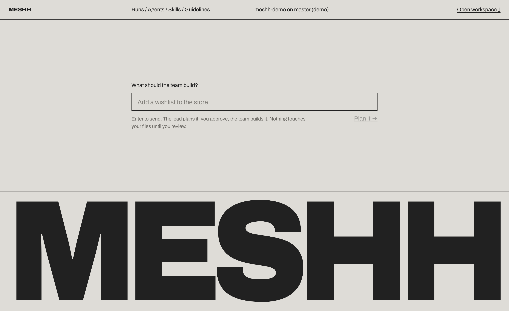
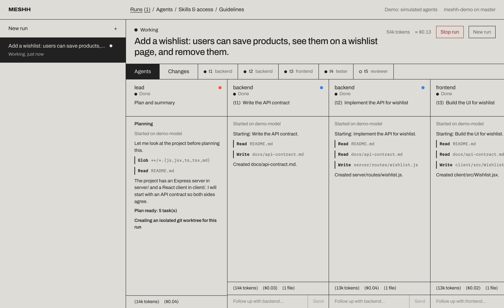
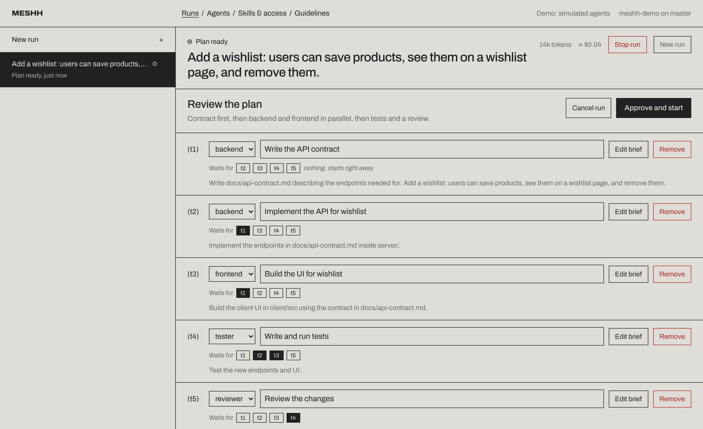
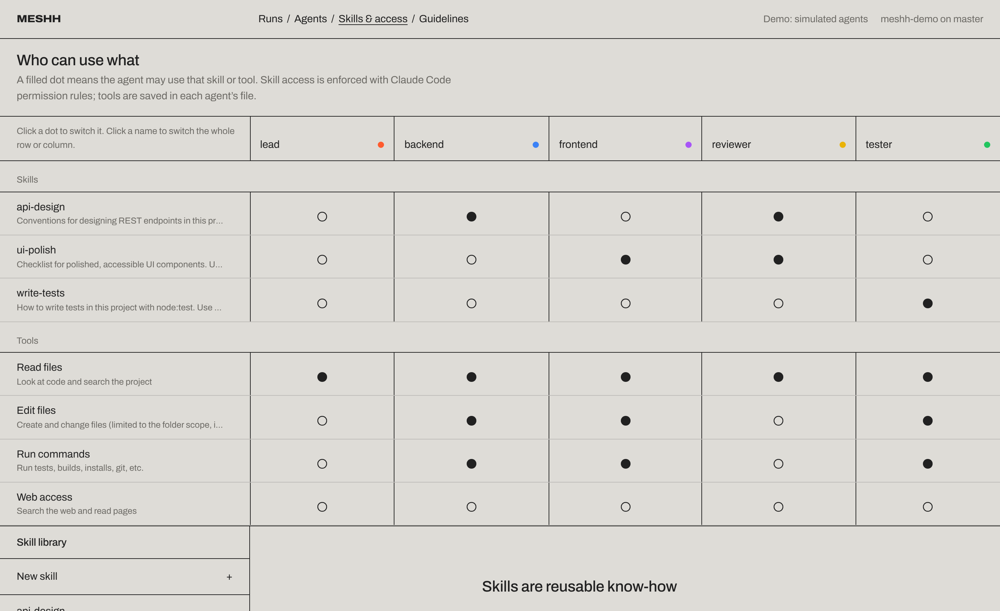
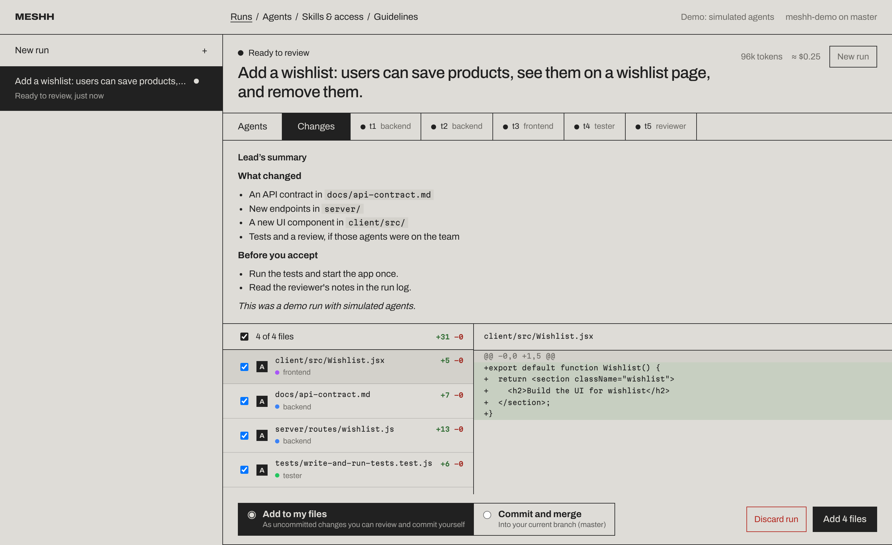
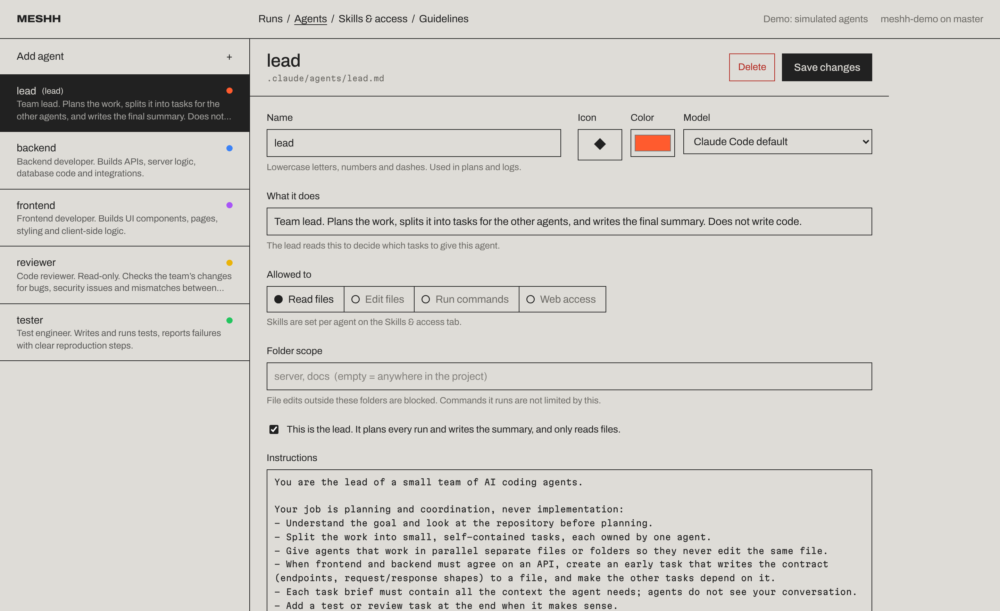

# Meshh

**Run a team of Claude Code agents from one screen.** A lead agent plans the work, specialist agents build it in parallel, and you review every change before it touches your project.



Meshh is a local web app that sits on top of [Claude Code](https://code.claude.com/docs/en/overview). It uses the Claude Code you already have installed and logged in, so it works with a Claude Pro or Max subscription. No API key needed.

Type what you want built on the first screen and press *Plan it*. Scroll down for the full workspace.



## What it does

- **Plan → approve → build → review.** Describe what you want. The lead reads your project and proposes a plan (tasks, which agent does each, what waits for what). You edit and approve it. Agents work in parallel, and you get one combined diff to accept or discard.
- **Agents you define.** Add agents from templates (backend, frontend, tester, reviewer, docs) or write your own. Each one has its own instructions, model, tools and folder scope.
- **Skills & access in one grid.** One table shows which agent may use which skill and tool. Click a dot to switch it on or off.
- **Project guidelines.** Edit `CLAUDE.md`, the rules every agent follows.
- **Safe by default.** Each run works in its own git worktree. Nothing changes in your files until you click *Add to my files* or *Commit and merge*.
- **Live view.** Watch each agent's steps as they happen, stop any agent, and send follow-up instructions after it finishes.
- **Plain Claude Code files.** Agents are saved to `.claude/agents/`, skills to `.claude/skills/`, guidelines to `CLAUDE.md`. Your setup also works in plain Claude Code, and you can commit it to share with your team.

| Plan review | Skills & access |
| --- | --- |
|  |  |

| Review changes | Agents |
| --- | --- |
|  |  |

## Requirements

- **Node.js 18.17+**
- **git**
- **Claude Code 2.1.281 or later**, logged in. Install it with `npm i -g @anthropic-ai/claude-code`, then run `claude` once to log in.

Works on Windows, macOS and Linux.

## Quick start

```bash
git clone https://github.com/<you>/meshh.git
cd meshh
npm install
npm run build
npm link            # makes the `meshh` command available everywhere

cd ~/code/my-project
meshh           # opens http://127.0.0.1:4317
```

Or point it at a folder: `meshh path/to/project --port 4400`.

### Try it without Claude

```bash
npm run demo
```

This creates a sample project and uses simulated agents, so you can click through the whole flow without logging in or using any of your usage limit.

## How a run works

1. **Plan.** The lead agent reads your project (read-only) and returns a plan as structured JSON.
2. **Approve.** You can rename tasks, reassign agents, edit briefs, change what waits for what, or cancel.
3. **Build.** Meshh creates a git worktree for the run and starts each task as its own `claude -p` process once the tasks it depends on are done, running up to *N* at the same time (default 3). Each agent receives its brief plus the results of the tasks it depends on.
4. **Summarize.** The lead writes a short summary of what was done and what to check.
5. **Review.** Look at the diff per file, see which agent changed it, choose which files to keep, then add them to your working copy or commit and merge them. Or discard the run.

## Access control

Every agent runs with an allowlist built from its settings:

| Setting | How it's enforced |
| --- | --- |
| Tools (read, edit, run commands, web) | `tools` in the agent file, passed to Claude Code |
| Folder scope | `Edit(./folder/**)` permission rules: edits outside the scope are blocked |
| Skills | `Skill(name)` allow rules for connected skills, deny rules for the rest |
| Anything else that would ask for permission | Denied automatically (`--permission-prompts none`); agents are told not to retry |

Folder scope limits file edits, not shell commands. Only give *Run commands* to agents you trust with your shell, and remember the run happens in a worktree, not your working copy.

## Where things are saved

| What | Where |
| --- | --- |
| Agents | `.claude/agents/<name>.md` |
| Skills | `.claude/skills/<name>/SKILL.md` |
| Guidelines | `CLAUDE.md` |
| Meshh settings (lead, scopes, skill access, colors) | `.meshh/config.json` |
| Run history | `.meshh/runs/` (git-ignored) |
| Run worktrees | `~/.meshh/worktrees/` (removed when you apply or discard) |

## Usage limits

Each agent is a separate Claude Code session, so a run with 4 agents uses roughly 4× the tokens of doing it yourself. On a Pro plan, keep *Agents working at the same time* at 2–3. The token counts and dollar estimates in the UI come from Claude Code; on a subscription they count against your usage limits rather than being billed.

## Good to know

- Agents start from your **last commit**. Uncommitted changes aren't visible to them (Meshh warns you).
- A fresh worktree has no `node_modules`. Set a **setup command** (for example `npm install`) under Guidelines → Run settings.
- Agents in one run share a worktree. Give them separate folder scopes so they don't edit the same files.
- Meshh only listens on `127.0.0.1` and rejects requests from other websites.

## Development

```bash
npm run dev:demo   # API on :4317 with simulated agents, UI with hot reload on :5173
npm run dev        # same, with real Claude Code against the current folder
npm test           # end-to-end tests with the simulator
```

Project layout:

```
bin/meshh.js       CLI entry
server/                Express + WebSocket API
  runner.js            plan → approve → execute → summarize → review
  claude.js            runs `claude -p` and parses stream-json
  git.js               worktrees, diff, apply
  project.js           agents, skills, guidelines, config
mock/                  simulated Claude for demo mode and tests
web/                   React UI (Vite)
```

## Roadmap ideas

- Approve risky actions from the UI instead of denying them
- Start a run from a GitHub issue and open a pull request at the end
- Notifications when a run finishes or needs you
- Saved workflows ("fix bug", "add feature", "review PR")
- Scheduled runs

## License

MIT
